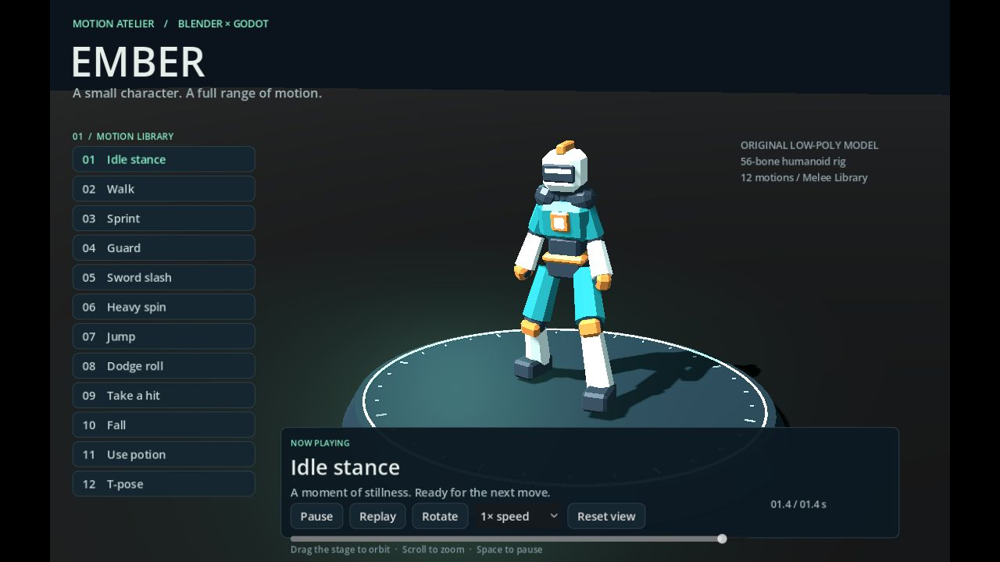

  <h1>Ember — Motion Atelier</h1>
  
A 3D character and animation showcase.

  

    
    
  

  
<a href="https://avocadough.github.io/ember-motion-atelier/">Open the browser demo</a> &nbsp;·&nbsp; <a href="https://github.com/Avocadough/ember-motion-atelier/blob/main/Source/Ember.blend">Editable model</a> &nbsp;·&nbsp; <a href="https://github.com/Avocadough/ember-motion-atelier/blob/main/THIRD_PARTY.md">Third-party credits</a> &nbsp;·&nbsp; <a href="https://github.com/Avocadough/ember-motion-atelier/blob/main/evidence/verification.md">Verification notes</a>

A 3D character and animation showcase for Exercise 6: an editable Blender model and a Godot scene using the supplied Mixamo Melee animation library.

Choose among 12 animations, control playback and inspect the character with the camera. This is an animation showcase, not an exploration game. A fresh local clone needs the pinned animation library fetched and prepared before opening the Godot project; the steps and licensing details are below.

| Explore the project | Contents |
| --- | --- |
| [Source/Ember.blend](Source/Ember.blend), [Assets/Character/](Assets/Character/) | Editable character and Godot-ready model |
| [Scenes/](Scenes/), [Scripts/](Scripts/) | Showcase scene, camera, controls and animation mapping |
| [Tools/](Tools/), [docs/](docs/) | Preparation and validation scripts; Web export |

---

## รายละเอียดโครงการ (ภาษาไทย)

เดโมตัวละคร 3D สำหรับแบบฝึกหัดที่ 6: สร้างโมเดลใน **Blender** และนำ **Mixamo Godot Animation Library (Melee)** มาใช้ใน **Godot**

**[เปิดเดโมผ่านเว็บ](https://avocadough.github.io/ember-motion-atelier/)**

## สิ่งที่ทำ

- สร้างหุ่น Ember ใหม่จาก cube, cone และ UV sphere ใน Blender 5.2.2 พร้อม bevel วัสดุ 5 แบบ และ armature 56 กระดูก
- ผูกน้ำหนักแบบชิ้นส่วนแข็ง เพื่อให้ชุดเกราะขยับตามข้อต่อโดยไม่ยืด รูปทรงและไฟล์ `.blend` เป็นงานสร้างใหม่ของโครงการนี้
- จัดแกน rest pose ให้ตรง `SkeletonProfileHumanoid` และตั้งชื่อกระดูกตาม Mixamo BoneMap จากแหล่งที่โจทย์ระบุ
- ใช้ `MeleeLib.res` จริง 12 ท่า: Idle, Walk, Sprint, Guard, Slash, Heavy spin, Jump, Roll, Hurt, Fall, Use potion และ T-pose
- สร้าง Scene Demo ตามตัวเลือกข้อ 3 ของโจทย์ และ export Web แบบไม่ใช้ threads สำหรับ GitHub Pages

## วิธีใช้

เลือกท่าจากแถบซ้าย กด Pause / Resume เพื่อหยุดหรือเล่นต่อ กด Replay เพื่อเล่นท่าโจมตีหรือท่าล้มอีกครั้ง เลือกความเร็ว 0.5× / 1× / 1.5× และลากแถบเวลาเพื่อดูท่าที่ต้องการ

ลากเมาส์บนเวทีเพื่อหมุนมุมกล้อง เลื่อนล้อเมาส์เพื่อซูม กด Rotate เพื่อหมุนอัตโนมัติ และ Reset view เพื่อคืนมุมเริ่มต้น ปุ่ม Space ใช้หยุด/เล่นต่อได้

## เปิดและแก้ไขต้นฉบับ

1. Clone repository นี้ แล้วรัน `powershell -File Tools/fetch_animations.ps1` เพื่อดึงไลบรารีจาก upstream ที่ล็อก revision ไว้
2. รัน `godot --headless --path . --script res://Tools/prepare_animations.gd` (แทน `godot` ด้วย path ของโปรแกรมในเครื่อง) เพื่อคัด 12 ท่าที่ใช้จริง จากนั้นเปิด `project.godot` ด้วย Godot 4.7.2 ขึ้นไป และกด F6 ที่ `Scenes/atelier.tscn` หรือ F5
3. เปิด `Source/Ember.blend` ใน Blender เพื่อแก้โมเดล วัสดุ และกระดูก ไฟล์ GLB ที่ใช้จริงอยู่ `Assets/Character/ember.glb`
4. สร้างโมเดลซ้ำได้ด้วย `blender --background --python Tools/create_character.py` หลังแก้ `.blend` ด้วยมือ ให้ export GLB จากไฟล์นั้นโดยตรงแทนการรันตัวสร้างซ้ำ
5. Export ด้วย preset `Web` ไปที่ `docs/index.html` และเผยแพร่ GitHub Pages จาก `main /docs`

## โครงสร้างและขั้นตอน

| ไฟล์ | หน้าที่ |
|---|---|
| `Source/Ember.blend` | โมเดล วัสดุ การผูกน้ำหนัก และกระดูกที่แก้ไขได้ |
| `Tools/create_character.py` | ขั้นตอนสร้างรูปทรงพื้นฐานและ export ที่ทำซ้ำได้ |
| `Assets/Character/ember.glb` | โมเดล skinned mesh สำหรับ Godot |
| `Assets/Animations/Mixamo BoneMap.tres` | BoneMap ตามแหล่งในโจทย์ |
| `Scripts/character.gd` | ใช้ BoneMap จับคู่ animation tracks กับกระดูกของโมเดล |
| `Scripts/atelier.gd` | เวที กล้อง และส่วนควบคุมเดโม |
| `Tools/validate.gd` | ตรวจแกน rest pose, ท่าทาง และการควบคุม playback |
| `docs/` | Web export พร้อมเปิดเล่น |

โมเดลนี้สร้าง armature เองใน Blender ให้เข้ากับชุดแอนิเมชัน ใช้แอนิเมชันจาก Mixamo ผ่านไลบรารีที่โจทย์ระบุ **ไม่ได้อัปโหลดโมเดลไปใช้บริการ Mixamo auto-rig** กระดูกมีแกนตรง Humanoid Profile อยู่แล้ว จึงใช้ BoneMap จับคู่ชื่อ track ได้โดยไม่ต้องแก้ rotation keyframe ท่า Root-motion ไม่ได้เลือกมาใช้ และตัดเฉพาะ track ของกระดูกอุปกรณ์ Weapon / Shield ที่ไม่มีในตัวละคร

## ตรวจสอบ

รัน `godot --headless --path . --script res://Tools/validate.gd` ต้องลงท้ายด้วย `VALIDATION_OK` ตรวจครบ 56 กระดูก แกน rest pose การเปลี่ยน pose ของแอนิเมชัน Pause / Resume และ Replay

ทดสอบ Web export ด้วยเบราว์เซอร์จริง: รายละเอียดผลอยู่ `evidence/verification.md`

## ข้อจำกัด

- เป็นเดโมแสดงท่าตามตัวเลือกในโจทย์ ไม่ใช่เกมที่เดินสำรวจฉาก
- หุ่นใช้มือรูปทรงเรียบ จึงไม่มีนิ้วที่มองเห็นแยกกัน แม้มี finger bones สำหรับความเข้ากันได้ของไลบรารี
- ท่าโจมตีและใช้ potion เป็นการแสดง gesture ไม่มีอาวุธหรือขวดเป็นพร็อพ
- เหมาะกับจอคอมพิวเตอร์และเมาส์ ต้องใช้เบราว์เซอร์ที่รองรับ WebGL 2 ดาวน์โหลดครั้งแรกประมาณ 40 MB

## แหล่งอ้างอิงและสิทธิ์

- วิดีโอตามโจทย์: [Blender modelling](https://www.youtube.com/watch?v=1fVCgQJmSew), [Animation 3D สำหรับ Godot](https://www.youtube.com/watch?v=My6gSiw21Fk) — ไม่มี transcript ที่ดึงได้ในเครื่องมือที่ใช้ จึงไม่อ้างว่าได้ตรวจเนื้อหาทุกช่วงของวิดีโอ
- [catprisbrey / Godot4-OpenAnimationLibraries](https://github.com/catprisbrey/Godot4-OpenAnimationLibraries), revision `ccc61c4d8cdc1fb7188a60ba4f51f7a3cac51df9` — MeleeLib และ Mixamo BoneMap ที่โจทย์กำหนด
- [Godot: Retargeting 3D Skeletons](https://docs.godotengine.org/en/stable/tutorials/assets_pipeline/retargeting_3d_skeletons.html)
- แอนิเมชันเป็นเนื้อหาบุคคลที่สาม ใช้ในเดโม ไม่อ้างว่าเป็นแอนิเมชันที่สร้างเอง และไม่แจก `.res` เป็นคลังแอนิเมชันแยกใน repository; ตัว Web export รวมข้อมูลที่ใช้แสดงเดโมไว้ในแพ็กเกม
- โมเดล Ember และโค้ดที่สร้างใหม่เผยแพร่ตาม MIT ใน `LICENSE` ไม่ครอบคลุมแอนิเมชัน BoneMap หรือ Godot runtime ซึ่งมีสิทธิ์ของต้นทาง ดู `THIRD_PARTY.md`
